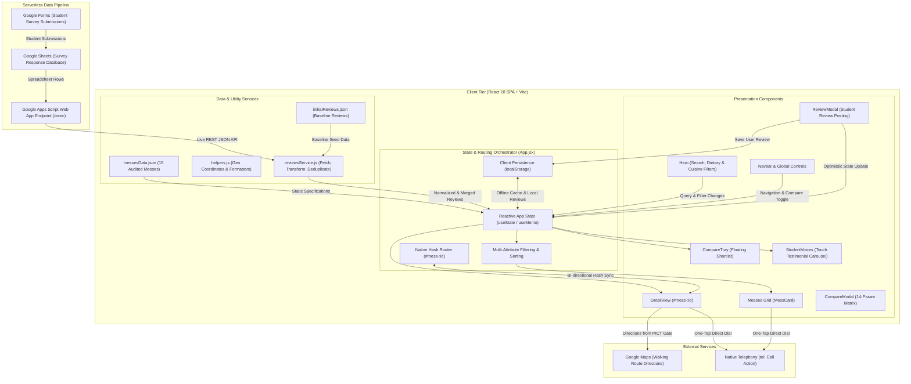

# 🍽️ MessMitra

> **Your mess, minus the mess.**  
> A hyper-local, student-audited web directory and comparison engine mapping 15 verified messes and canteens around **PICT Pune (Dhankawadi)**.

---

## 📌 Overview

**MessMitra** is designed to solve a daily struggle for outstation and hostel students at **Pune Institute of Computer Technology (PICT)**: finding healthy, hygienic, and affordable daily meals without trial-and-error.

Every listing is backed by an in-person campus survey auditing real plate prices, monthly subscriptions, walking distances, Sunday dinner availability, kitchen hygiene, and drinking water facilities.

---

## 🚀 Key Features & Capabilities

### 🔍 1. Smart Search & Instant Filtering
* **Live Keyword Search:** Debounced instant lookup across mess names, owners, cuisines, tags, and specialties (e.g., `"North Indian"`, `"RO"`, `"Unlimited"`).
* **Dietary Filter:** Instant toggle between **Pure Veg** and **Veg & Non-Veg**.
* **Cuisine Filters:** Categorized by **Maharashtrian**, **North Indian**, **Kokani Coastal**, and **Multi-Cuisine**.
* **Dynamic Sorting:** Sort by **Recommended**, **Closest first** (walking meters), **Lowest plate** (from ₹80), or **Highest rated**.

### 📋 2. Comprehensive Mess Profiles
* **Transparent Pricing:** Full rate breakdown for single daily plates (Veg / Egg / Non-Veg), monthly passes (1 meal/day and 2 meals/day), Sunday feasts, and room delivery terms.
* **Operational Timings:** Exact lunch and dinner operating hours, plus a dedicated **Sunday Night Open** indicator (critical for hostelers when most messes close).
* **Hygiene & Facilities:** On-site drinking water audit (**Certified RO Purifier** vs. **Normal Filter Jar**), seating capacity, handwash basins, and daily disinfection standards.
* **One-Tap Actions:** Direct dial to mess owners (`tel:`) and instant **Google Maps Walking Directions** from the PICT gate.
* **Audit Metadata:** Transparently displays survey date and auditor roll number for each mess.

### ⚖️ 3. Side-by-Side Comparison Engine
* Shortlist up to **3 messes** simultaneously via a floating bottom tray.
* Interactive side-by-side comparison matrix evaluating **14 critical parameters** (pricing, timings, Sunday night service, water system, distance, seating, and ratings).

### ✍️ 4. Student Reviews & Multi-Attribute Ratings
* **5-Point Attribute Ratings:** Students rate not just an arbitrary star score, but 4 crucial dimensions:
  * 🍛 **Taste & Homeliness**
  * 🧼 **Hygiene & Cleanliness**
  * 🌿 **Gut Comfort & Digestion**
  * 💰 **Value for Money**
* **PICT Student Verification:** Automatic detection of `@pict.edu` email IDs to award the **🎓 Verified PICT Student** badge.
* **Instant Submission Workflow:** Streamlined, zero-friction review posting with immediate local-first synchronization and persistent storage.
* **Live Google Sheets Integration:** Fetches live student survey responses through a deployed Google Apps Script web service, merged with local browser caching.

### 🎙️ 5. "Student Voices" Review Carousel
* Interactive, touch-swipeable review carousel displaying real student testimonials, ratings, and feedback on the home screen.

---

## 🍱 Directory Snapshot (15 Verified Messes)

| # | Mess Name | Type | Cuisine | Distance | Single Plate | Sunday Night |
|---|---|---|---|---|---|:---:|
| 1 | **Kirteshwar Khanawal** | Veg & Non-Veg | Maharashtrian | 250m | ₹80 | ✅ Open |
| 2 | **Deep's Kitchen** | Veg & Non-Veg | Maharashtrian | 250m | ₹80 | ❌ Closed |
| 3 | **Aai Mess** | Pure Veg | Maharashtrian | 250m | ₹80 | ❌ Closed |
| 4 | **Kashi Vishweshwar Mess** | Veg & Non-Veg | Maharashtrian | 250m | ₹80 | ❌ Closed |
| 5 | **Hotel Abhiruchi** | Veg & Non-Veg | Multi-Cuisine | 500m | ₹90 | ✅ Open |
| 6 | **Jay Shankar Mess** | Veg & Non-Veg | Maharashtrian | 300m | ₹80 | ❌ Closed |
| 7 | **SK Dining (Santosh Mess)** | Pure Veg | North Indian | 260m | ₹90 | ❌ Closed |
| 8 | **Sadguru Mess** | Pure Veg | North Indian | 250m | ₹80 | ✅ Open |
| 9 | **Sujata Mess** | Veg & Non-Veg | Maharashtrian | 250m | ₹100 | ❌ Closed |
| 10 | **Hotel Maitri Katta** | Veg & Non-Veg | Multi-Cuisine | 500m | ₹90 | ❌ Closed |
| 11 | **Kokan Katta** | Veg & Non-Veg | Kokani Coastal | 300m | ₹100 | ❌ Closed |
| 12 | **Shankar Maharaj Mess** | Veg & Non-Veg | Maharashtrian | 350m | ₹100 | ❌ Closed |
| 13 | **Annapurna Dining Centre** | Veg & Non-Veg | Multi-Cuisine | 850m | ₹90 | ❌ Closed |
| 14 | **Madhura Mess** | Veg & Non-Veg | Maharashtrian | 170m | ₹90 | ❌ Closed |
| 15 | **PICT Campus Canteen & Mess** | Pure Veg | Multi-Cuisine | 0m (Campus) | ₹80 | ❌ Closed |

---

## 🏗️ System & Project Architecture

MessMitra is architected as a **Client-Side Single-Page Application (SPA)** with a **hybrid local-first data pipeline** backed by serverless cloud integrations. This ensures instant page loads, offline resiliency, deep linkability, and real-time community data synchronization without requiring a paid server backend.

### 📐 High-Level Architecture Diagram



---

### 🧩 Architectural Layers & Components

#### 1. Presentation & UI Layer (React 18 & Tailwind CSS)
* **`App.jsx` (Root Orchestrator):** Manages central state for search queries, dietary preferences, active cuisine selections, sort orders, shortlisted comparison IDs, toast notifications, and aggregated reviews.
* **`Navbar.jsx`:** Sticky navigation header featuring brand iconography, dynamic compare counter pill badge, quick navigation triggers, and context-sensitive views (Home vs. Detail).
* **`Hero.jsx`:** Interactive hero banner offering instantaneous keyword search, one-click dietary filter pills (**Pure Veg** vs. **Veg & Non-Veg**), cuisine dropdown selector, and dynamic directory counters.
* **`MessCard.jsx`:** Responsive directory card displaying distance badges, starting plate prices, Sunday night indicators, cuisine tags, comparison selection checkboxes, and detail view triggers.
* **`DetailView.jsx`:** Comprehensive profile view rendered via hash routing (`#mess-:id`). Contains full price breakdowns (daily plates, 1x/2x monthly passes, delivery), operational timings, certified water audit, seating capacity, weekly schedule, Google Maps walking navigation, direct phone calling, and review feeds.
* **`CompareTray.jsx` & `CompareModal.jsx`:** Bottom-docked tray tracking up to 3 selected messes and opening a full-screen 14-parameter side-by-side comparison matrix.
* **`ReviewModal.jsx`:** Review submission dialog with star ratings, 4-attribute evaluation, feedback text, student email capture, and client-side `@pict.edu` domain verification.
* **`StudentVoices.jsx`:** Touch-enabled, auto-scrolling horizontal review carousel spotlighting authentic feedback from verified PICT students.
* **`Toast.jsx` & `StarRating.jsx`:** Modular UI components for non-intrusive notification feedback and accessible SVG star ratings.

---

#### 2. Hybrid 3-Tier Data Pipeline & Review Aggregation
To achieve lightning-fast initial load times while supporting real-time community updates, MessMitra uses a **three-tier data synchronization architecture**:

```text
┌────────────────────────────────────────────────────────────────────────┐
│                        3-Tier Review Pipeline                          │
├────────────────────────────────┬───────────────────────────────────────┤
│ Tier 1: Bundled Baseline Data  │ • initialReviews.json loaded on boot  │
│                                │ • Guarantees 0ms initial render       │
├────────────────────────────────┼───────────────────────────────────────┤
│ Tier 2: Local-First Storage    │ • localStorage ('messmitra-reviews-X')│
│                                │ • Persists locally submitted reviews  │
│                                │ • Caches latest Google Sheets response│
├────────────────────────────────┼───────────────────────────────────────┤
│ Tier 3: Asynchronous Live Sync │ • Google Apps Script Web App (/exec)  │
│                                │ • 12-second AbortController timeout   │
│                                │ • Normalizes multi-attribute survey   │
│                                │ • Deduplicates via emailKey & IDs     │
└────────────────────────────────┴───────────────────────────────────────┘
```

1. **Instant First Paint:** On initial mount, `App.jsx` combines pre-bundled baseline reviews (`initialReviews.json`) with locally persisted reviews (`localStorage`).
2. **Background Live Synchronization:** `fetchSheetReviews()` asynchronously queries the Google Apps Script REST endpoint (`AKfycbx4A60409.../exec`) with an `AbortController` timeout (12s).
3. **Data Normalization (`transformSheetData`):** Parses raw rows from Google Form responses, matches mess names via fuzzy matching (`findMessByName`), parses multi-attribute metrics (Taste, Hygiene, Gut Comfort, Value for Money), computes composite rating scores, and extracts user initials.
4. **Deduplication Engine (`mergeReviews`):** Merges remote sheet responses with local user reviews, eliminating duplicates using composite keys (`emailKey` || `id` || `name-date`).

---

#### 3. Client-Side Hash Routing Architecture
* **Zero-Configuration Routing:** Uses browser `window.location.hash` (`#mess-:id`) instead of standard browser history push-states.
* **Deep Linking:** Students can share direct URLs to specific mess profiles (e.g., `https://messmitra.vercel.app/#mess-1`).
* **Static Hosting Friendly:** Operates seamlessly on any static CDN (Vercel, GitHub Pages) without requiring server-side rewrite rules (`_redirects` or `rewrites`).
* **History Navigation & Scroll Management:** Synchronizes browser Back/Forward navigation with state transitions and automatically resets scroll positions to the top.

---

#### 4. Geolocation & External Integration Architecture
* **Strict Coordinate Validation (`getMessCoordinates` in `helpers.js`):** Validates that mess coordinates are finite numbers within valid geographic bounds (latitude $[-90^\circ, 90^\circ]$, longitude $[-180^\circ, 180^\circ]$).
* **Walking Directions Engine (`mapsDirections`):** Generates universal Google Maps walking navigation URLs originating from the **PICT Pune Main Gate** (`18.4575° N, 73.8508° E`).
* **Direct Telephony Integration (`tel:`):** Formats verified phone numbers for direct one-tap dialing on mobile devices.

---

#### 5. Security, Validation & Reliability
* **PICT Student Verification:** Client-side regex verification ensures that reviewers with `@pict.edu` email addresses are awarded the official **🎓 Verified PICT Student** trust badge.
* **Fault-Tolerant Network Fallbacks:** If the Google Apps Script endpoint experiences rate limits, network outages, or ad-blocker interference, the application gracefully falls back to `messmitra-sheet-cache` and bundled JSON without crashing.
* **XSS Defense:** Strict React JSX escaping prevents cross-site scripting from user-submitted reviews and Google Sheet comment fields.

---

## 🛠️ Tech Stack

* **Frontend:** [React 18](https://react.dev/) (Single Page Application with hash routing)
* **Build System:** [Vite 6](https://vitejs.dev/)
* **Styling:** [Tailwind CSS 3](https://tailwindcss.com/) with custom brand theme and typography
* **Icons:** [Lucide React](https://lucide.dev/)
* **Typography:** Plus Jakarta Sans & Inter
* **Backend / Data Sync:** Google Apps Script Web App REST API connected to Google Sheets + client-side `localStorage` sync
* **Hosting:** Optimized for static deployments (Vercel, Cloudflare Pages, Netlify)

---

## 📂 Project Structure

```text
MessMitra/
├── public/                     # Static assets & brand logos
│   ├── logo-full.png           # Primary full logo with wordmark
│   ├── logo-horizontal.png     # Horizontal brand badge
│   ├── logo-icon.png           # Icon badge
│   └── logo-symbol.png         # Standalone app symbol
├── src/
│   ├── components/             # Modular React UI components
│   │   ├── BottomCta.jsx       # Bottom call-to-action banner
│   │   ├── CompareModal.jsx    # 14-parameter side-by-side comparison modal table
│   │   ├── CompareTray.jsx     # Floating bottom shortlist comparison tray
│   │   ├── DetailView.jsx      # In-depth mess profile page (#mess-:id)
│   │   ├── Footer.jsx          # Footer with category quick links & credits
│   │   ├── Hero.jsx            # Hero search bar, dietary & cuisine filters
│   │   ├── MessCard.jsx        # Directory card item with quick actions & specs
│   │   ├── Navbar.jsx          # Sticky frosted-glass navigation bar with compare badge
│   │   ├── ReviewModal.jsx     # Student review submission modal with PICT badge check
│   │   ├── StarRating.jsx      # Reusable SVG star rating component
│   │   ├── StudentVoices.jsx   # Automated touch-swipeable reviews carousel
│   │   ├── Toast.jsx           # Toast notification system
│   │   └── WhyChooseUs.jsx     # Key student-focused value propositions
│   ├── data/
│   │   ├── initialReviews.json # Pre-bundled baseline student reviews
│   │   └── messesData.json     # Curated 15-mess database with audited specs & coordinates
│   ├── services/
│   │   └── reviewsService.js   # Google Sheets & Google Apps Script API sync & transformation
│   ├── utils/
│   │   └── helpers.js          # Currency, coordinate validation, walking routes & storage
│   ├── App.jsx                 # Main application orchestrator, filter engine & hash router
│   ├── index.css               # Tailwind CSS directives & custom styling
│   └── main.jsx                # React root application entry point
├── index.html                  # HTML5 entry page with viewport & SEO meta tags
├── package.json                # Project dependencies and npm scripts
├── postcss.config.js           # PostCSS configuration for Tailwind CSS & Autoprefixer
├── tailwind.config.js          # Custom theme tokens, colors, and typography
└── vite.config.js              # Vite build tool and development server configuration
```

---

## 💻 Getting Started

### Prerequisites
* **Node.js** (v18.0.0 or higher recommended)
* **npm** or **yarn**

### Installation

1. **Clone or navigate into the repository:**
   ```bash
   cd MessMitra
   ```

2. **Install dependencies:**
   ```bash
   npm install
   ```

3. **Start the local development server:**
   ```bash
   npm run dev
   ```
   Open [http://localhost:5173](http://localhost:5173) in your browser.

4. **Build for production:**
   ```bash
   npm run build
   ```
   The production-ready assets will be generated inside the `dist/` directory.

5. **Preview production build:**
   ```bash
   npm run preview
   ```

---

## 👥 Contributors & Survey Credits

Built as part of a **Community Engagement Project (CEP)** by students of **Pune Institute of Computer Technology (PICT)** to help freshers and hostelers navigate mess options around Dhankawadi, Pune.
